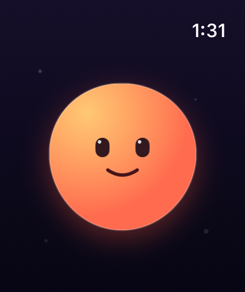

# Doboo

Doboo is a standalone Apple Watch character prototype: a small, soft creature
that feels alive through touch, motion, expression, and haptic feedback.

The first vertical slice deliberately excludes health data and long-term pet
systems. It tests the core sensation first: press or drag anywhere on the watch
screen and Doboo dents toward the contact, stretches, follows the finger, changes
expression, and springs back with haptic feedback when released.

## Build

- Xcode 26 or later
- watchOS 11 or later
- Generate the project with `xcodegen generate`.
- Build with `xcodebuild -project Doboo.xcodeproj -scheme Doboo -sdk watchsimulator build`.
- Run the platform-independent model tests with `swift test`.

## Project boundary

Doboo and `squeeez!` are separate products and separate repositories.
`squeeez!` may be studied as a reference for soft-body feel, squash-and-stretch,
and feedback timing, but its code, assets, product scope, and Git history do not
belong to Doboo unless the owner explicitly requests a port.

The UI is native SwiftUI and drawn entirely in code so deformation stays live at
watch scale without shipping borrowed art or code from another product.
